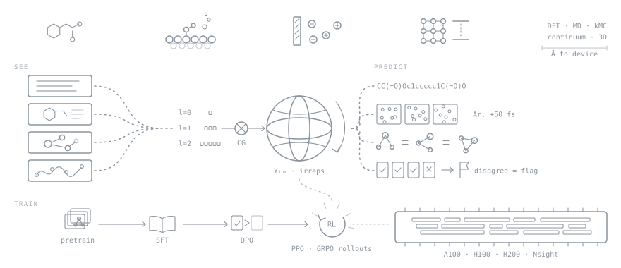

  

<b>I build AI that already knows the laws of physics, and I make it train fast.</b>

Ph.D. @ UCLA '26 &nbsp;·&nbsp; equivariant pretraining &nbsp;·&nbsp; post-training &nbsp;·&nbsp; GPU training

 

<table>
  <tr>
    <td width="25%" valign="top">SIMULATE   <b>multi-scale physics</b> DFT · force fields · MD · kMC · continuum <b>Å → device</b> one stack   <b>automated pipelines</b> DFT sampling → force-field fit → MD <b>end to end</b> automated</td>
    <td width="25%" valign="top">SEE   <a href="https://github.com/yaniguan/ouroboros-ocsr"><b>ouroboros-ocsr</b></a> molecule images to SMILES <b>54.0%</b> exact match   <a href="https://arxiv.org/abs/2608.22183"><b>VERDICT</b></a> label-free error flags <b>0.916</b> AUROC</td>
    <td width="25%" valign="top">MODEL   <a href="https://github.com/yaniguan/WignerFlow"><b>WignerFlow</b></a> equivariant MD, argon so far <b>25.8 ns/day</b> one A100   <a href="https://github.com/yaniguan/YLM"><b>YLM</b></a> a language model that reads 3D <b>&lt; 1e-9</b> equivariance error</td>
    <td width="25%" valign="top">TRAIN   <a href="https://github.com/yaniguan/labbench-posttrain"><b>labbench-posttrain</b></a> RL from wet-lab protocols <b>49,139</b> records   <a href="https://github.com/yaniguan/equivariant-gpu-lab"><b>equivariant-gpu-lab</b></a> equivariance meets the GPU <b>A100 → H100</b> roofline</td>
  </tr>
</table>

 

SFT → DPO → GRPO &nbsp;&nbsp;|&nbsp;&nbsp; A100 · H100 · H200 · Nsight &nbsp;&nbsp;|&nbsp;&nbsp; linear algebra · group theory · statistics · stat mech

    long drives · my dog · two Canons · Shakespeare

<a href="https://yaniguan.github.io"> yaniguan.github.io</a>

